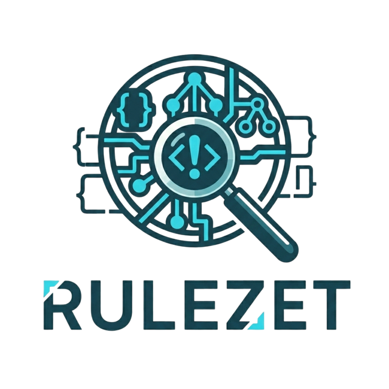

  

  <strong>The open source security intelligence repository for detection rules.</strong> 
  Share, evaluate, test and improve detection rules — together.

  <a href="https://rulezet.org">rulezet.org</a> &nbsp;·&nbsp;
  <a href="https://rulezet.org/api/">API</a> &nbsp;·&nbsp;
  <a href="https://github.com/rulezet/rulezet-core">Source code</a> &nbsp;·&nbsp;
  <a href="https://github.com/rulezet/rulezet-core/issues">Report an issue</a>

---

## About

**Rulezet** is an open source platform where security teams and researchers publish, review and
maintain cybersecurity detection rules. Every rule is parsed and checked when it is added, linked
to the vulnerabilities (CVE) and MITRE ATT&CK techniques it covers, scored for quality, and
improved by the community through votes, comments and edit proposals.

Rulezet is available as a public service at [rulezet.org](https://rulezet.org), and can be
self-hosted. Instances can synchronise with each other through connectors.

**Supported formats** — YARA, Sigma, Suricata, Zeek, OWASP CRS, Nova, NSE, Wazuh, Elastic, and
more: new formats plug into the platform without changing its import pipeline.

## What you can do with Rulezet

| | |
|---|---|
| **Find** | Search every rule by format, tag, CVE or ATT&CK technique; follow a vulnerability or a technique on its own page with every rule that covers it. |
| **Write** | Create rules in a dedicated editor with completion, live validation and dependency handling, or import them from GitHub repositories, files and JSON. |
| **Test** | Run rules on sample sets in a sandbox before publishing: detections, misses and false positives, kept for every version of a rule. |
| **Share** | Group rules into bundles, export them (files, JSON, MISP, STIX) and keep mirrors of the whole collection on GitHub. |
| **Improve** | Vote, comment and propose edits; every rule keeps its full history and a quality score. |

## Projects

| | Repository | Description |
|:---:|---|---|
|  | [**rulezet-core**](https://github.com/rulezet/rulezet-core) | The Rulezet platform: web application, REST API, connectors and administration. |
|  | [**rulezet-editor**](https://github.com/rulezet/rulezet-editor) | Standalone, pluggable editor for detection rules (YARA first; Sigma, Suricata and more to come). |
|  | [**rulezet-tester**](https://github.com/rulezet/rulezet-tester) | Runs detection rules on sample sets in a sandbox: detections, misses, false positives. |
|  | [**rulezet-cast**](https://github.com/rulezet/rulezet-cast) | Parser and normalizer that converts multi-format detection signatures into structured JSON. |
|  | [**rulezet-validation**](https://github.com/rulezet/rulezet-validation) | Scans Rulezet's YARA rules against known-clean binaries and quarantines the rules that fire on them. |
|  | [**rulezet-rulesets**](https://github.com/rulezet/rulezet-rulesets) | Read-only mirror of every rule published on the official instance. |
|  | [**rulezet-sample-rules**](https://github.com/rulezet/rulezet-sample-rules) | Ready-to-import rules in multiple formats for workshops, CTFs and training sessions. |
|  | [**rulezet-workshop**](https://github.com/rulezet/rulezet-workshop) | Workshop materials: slide deck, hands-on exercises and demo resources. |
|  | [**rulezet-scripts**](https://github.com/rulezet/rulezet-scripts) | Scripts to work with rulezet.org from the command line. |

## Get involved

- **Use it** — browse and download rules on [rulezet.org](https://rulezet.org), or query the [API](https://rulezet.org/api/).
- **Contribute rules** — publish your own rules or import your repositories; propose fixes to existing ones.
- **Contribute code** — pull requests are welcome on every repository; new rule formats are a good place to start.
- **Report** — bugs and ideas go to the [issue tracker](https://github.com/rulezet/rulezet-core/issues) of the repository concerned.

## Funding

Rulezet is developed by [CIRCL](https://www.circl.lu/) (Computer Incident Response Center Luxembourg)
and co-funded by the European Union under the
[FETTA](https://www.circl.lu/pub/press/20240131/) project (Federated European Team for Threat Analysis).

  

